  

 

> **Convierte tu Android TV, TV Box, móvil o tablet en un Centro Multimedia y Servidor NAS P2P 100% nativo en Kotlin.**
> Sin servidores intermedios en la nube · Sin anuncios · Lectura y escritura directa en USB NTFS sin root · Acceso cifrado punto a punto desde cualquier navegador Web u otro dispositivo Android.

[🚀 Descargar APK](https://github.com/multimimedia/multimimedia.github.io/releases/latest/download/Hemeroteca.apk) •
[🔒 Conectar con Código HMR](https://multimimedia.github.io/#conectar) •
[🗄️ Centro NAS](https://multimimedia.github.io/#funciones) •
[🎧 Audio Hi-Fi & Auto](https://multimimedia.github.io/#hifi) •
[💎 Planes y Precios](https://multimimedia.github.io/#precios)

 

## ✨ ¿Por qué Hemeroteca es único?

A diferencia de otras soluciones como Emby, Plex o Jellyfin que dependen de servidores PC externos o envolturas web pesadas, **Hemeroteca corre de forma 100% nativa en Android y Android TV**:

* **📱 TV Box, Android TV y Móvil como Servidor Real**: Tu propia biblioteca vive en tu casa, conectada por Wi-Fi local, **Tailscale**, o por **Internet P2P WebRTC (DTLS 1.2/1.3)** sin abrir puertos en el router.
* **🔌 Driver USB NTFS Propio sin Root**: Lee y escribe directamente a nivel de bloque en discos duros USB con formato **NTFS, exFAT y FAT32**, incluso en televisores donde Android ha bloqueado el acceso externo.
* **🔒 Privacidad Absoluta**: Tus archivos, fotos y contraseñas **jamás se suben a servidores de terceros**. El streaming y las transferencias viajan directamente entre tu servidor y tu pantalla.
* **🌐 Doble Interfaz (Nativa + Web HTTPS)**: Conéctate con la app nativa en otro móvil, tablet o TV, en el coche con **Android Auto**, o desde **cualquier navegador Web** entrando en `https://multimimedia.github.io/HMR-XXXX-YYYY`.

 

## 🎬 Escaparate Hub, Cine, Series y Canales

<table>
<tr>
<td width="50%" valign="top">

### 🍿 Cine y Series con Metadatos
* Vista moderna **Escaparate Hub** con hero banner animado y fila **«Seguir Viendo»** sincronizada al segundo.
* Descarga automática de **carátulas, pósters, banners, sinopsis, valoración, director, año y reparto** (TMDB / TVDB y ficheros locales).
* Soporte completo de sagas, temporadas, episodios e historial multi-dispositivo.

</td>
<td width="50%" valign="top">

### 📺 Tus Propios Canales de YouTube y Galería
* Organiza tus canales descargados o podcasts con su **avatar, banner, fechas y buscador instantáneo**, exactamente como si estuvieras en YouTube y **sin anuncios**.
* **Galería Dinámica** para fotos y vídeos personales con soporte de **fotografía RAW profesional** (`CR2`, `NEF`, `ARW`, `DNG`).

</td>
</tr>
<tr>
<td width="50%" valign="top">

### ⚡ Transcodificación por Hardware y Todos los Formatos
* Motor nativo con aceleración por hardware (`h264_mediacodec`) y **FFmpeg**.
* Reproduce formatos modernos y antiguos sin problema: **`AVI`, `DivX`, `XviD`, `WMV`, `FLV`, `MPG`, `MPEG`, `VOB`, `3GP`, `MKV`, `MP4`, `MOV`, `WebM`, `TS`, `HEVC / H.265`, `AV1`**.
* Streaming adaptativo HLS con selector multi-audio.

</td>
<td width="50%" valign="top">

### 🔤 Subtítulos Externos Automáticos (`.SRT` y `.VTT`)
* Detecta automáticamente cualquier archivo **`.srt`** o **`.vtt`** colocado junto a tus películas o episodios (en disco interno, USB NTFS o unidades SMB/WebDAV).
* Detección automática de idioma y **conversión al vuelo a WebVTT** con selector **`CC`** integrado en el reproductor Web.

</td>
</tr>
</table>

 

## 🎧 Audio Hi-Fi Audiófilo y Android Auto

| 🎚️ Ecualizador DSP de 10 Bandas | 🎧 Modo Bit-Perfect y DAC USB | 💿 Discografías al Instante | 🚗 Integración Android Auto |
| :---: | :---: | :---: | :---: |
| Control total con 10 bandas (`31Hz` a `16kHz`), **Pre-Amplificador** y **Bass Boost**. | Salida digital pura sin remuestreo directo a tu **DAC USB externo** o equipo Hi-Fi. | Busca **cantantes, discografías completas, álbumes, carátulas y canciones**. | Lleva toda la música de tu servidor en directo a la pantalla de tu coche. |

* Compatible con formatos con y sin pérdida: **`FLAC`, `WAV`, `OPUS`, `AAC`, `M4A`, `OGG`, `MP3`, `WMA`**.
* Cola de reproducción inteligente, modo segundo plano persistente y listas personalizadas.

 

## 🗄️ Centro NAS y Almacenamiento Avanzado

Desde **Avatar → `🗄️ Centro NAS y Copias Automáticas`**, Hemeroteca convierte tu TV Box o Android en un verdadero NAS doméstico compatible con móvil, navegador y ordenador:

| Función NAS | Descripción Detallada |
| :--- | :--- |
| **📸 Copia Automática Selectiva** *(Auto-Backup)* | Tu nube privada sin cuotas ni duplicados. Elige con casillas qué copiar (**📷 Cámara**, **🖼️ Imágenes y Capturas**, **🎬 Vídeos**, **📄 Documentos y Descargas**) o añade carpetas personalizadas con `+ Añadir carpeta`. Elige destino (**💾 Disco Local / USB NTFS** o **🌐 Servidor Remoto P2P**), activa **`Solo Wi-Fi`** y sincroniza al instante o automáticamente en segundo plano cada 15 minutos (`WorkManager`). |
| **🖥️ Servidor WebDAV NAS** *(Windows / Mac)* | Monta todos los volúmenes de tu servidor (incluidos discos USB NTFS, exFAT y FAT32) como una unidad de red **`Z:\`** en Windows Explorer o Finder (`Cmd+K`) en macOS mediante `http://IP:8080/webdav/` con autenticación de usuario/contraseña. |
| **🗑️ Papelera de Reciclaje NAS** *(`.hemeroteca_trash`)* | Interruptor para proteger tus datos ante borrados accidentales desde el Explorador Remoto o WebDAV. Restaura cualquier archivo o carpeta a su ruta original con un toque o vacía la papelera cuando quieras. |
| **📊 Panel de Salud en Tiempo Real** | Monitoriza RAM usada/total, núcleos y estado térmico de CPU, clientes activos, tráfico servido, transcodificaciones en curso, tamaño de la papelera y barras de capacidad libre/ocupada de todos los discos montados. |
| **🔗 Enlaces Temporales (`/s/{token}`)** | Genera enlaces de descarga directa para compartir un archivo puntual (1 hora, 24 horas o 7 días) con **contraseña opcional**, contador de descargas y revocación inmediata (compatible en LAN y por túnel HTTPS sin abrir puertos). |
| **🔌 Driver USB NTFS / exFAT / FAT32 + SMB/WebDAV** | Lee y escribe en discos USB NTFS sin root, monta carpetas compartidas de PC o NAS por **SMB2/SMB3 y WebDAV** como cliente, y gestiona archivos remotamente con **subidas y descargas bidireccionales** reanudables. |

 

## 🔐 Seguridad, Cifrado P2P y Control Familiar

* **🛡️ Cifrado Punto a Punto WebRTC (DTLS 1.2 / 1.3)**: La señalización inicial solo negocia la conexión directa; los vídeos, fotos, documentos y contraseñas viajan cifrados directamente entre tu servidor y tu navegador o app.
* **👥 Control Total de Usuarios y Bibliotecas**:
  * Aprueba manualmente quién puede entrar.
  * Elige si cada cuenta accede solo en **Wi-Fi Local**, en **Remoto** o **Ambos**.
  * Selecciona con casillas exactamente qué **bibliotecas, subcarpetas o archivos individuales** puede ver o reproducir cada persona.
* **🔒 Acceso Web Privado (Estilo Splash)**:
  * **Sin registro público abierto**: Nadie externo puede crearse una cuenta desde Internet; únicamente existen los usuarios creados por el administrador del servidor.
  * **Bloqueo progresivo inteligente anti-fuerza bruta**: Tras 5 fallos → pausa de 1 min; 10 fallos → 5 min; 15+ fallos → 30 min (con restablecimiento automático al iniciar sesión correctamente).
* **🔑 Vinculación Rápida por QR**: Escanea un código QR para autorizar un TV o móvil al instante sin teclear contraseñas con el mando.

 

## 💎 Planes y Precios

El **Modo Reproductor Local y App Cliente es gratis para siempre**, sin cuenta ni tarjeta. Para convertir un dispositivo en **Servidor Remoto y NAS** dispones de **14 días de prueba gratuita completa**:

| Plan | Precio | Dispositivos Vinculados | Incluye |
| :--- | :---: | :---: | :--- |
| **Reproductor Local y Cliente** | **0 €** *(Siempre gratis)* | Ilimitado en local / cliente | Reproductor local USB NTFS/exFAT/FAT32, DAC USB Hi-Fi, Android Auto y app cliente P2P. |
| **Prueba Servidor & Cloud** | **0 €** *(14 días)* | 1 Servidor + 2 dispositivos | Todas las funciones de Servidor, Código `HMR-XXXX-YYYY`, Web HTTPS y Centro NAS completo. |
| **Plan Estándar** | **2,99 € / mes** | 1 Servidor + 10 dispositivos | Streaming WebRTC P2P 4K, Centro NAS, WebDAV, Auto-Backup y Explorador Bidireccional. |
| **Plan Pro / Familiar** | **4,99 € / mes** | 1 Servidor + 25 dispositivos | Ideal para toda la familia: Smart TVs, móviles, tablets, coches y viajes. |
| **Pro Anual** 🔥 | **29,99 € / año** *(Ahorra 50%)* | 1 Servidor + 25 dispositivos | Equivale a **2,50 €/mes** con todas las funciones Servidor, NAS, P2P y Hi-Fi. |
| **Licencia Lifetime** 👑 | **39,99 €** *(Pago único)* | 1 Servidor + 25 dispositivos | **Para siempre, sin cuotas mensuales.** Todas las actualizaciones y soporte directo prioritario. |

*(Incluye canal de **💬 Soporte Directo con el Desarrollador** dentro de la propia aplicación).*

 

## 🧭 Guía Rápida

<b>📲 1. Instalar la App y Conectar con Código (Android / Android TV / Web)</b>

1. Descarga e instala [`Hemeroteca.apk`](https://github.com/multimimedia/multimimedia.github.io/releases/latest/download/Hemeroteca.apk) en tu Android TV, TV Box o móvil (Android 8.0 – 16).
2. En tu **Servidor**, añade tus carpetas o discos USB y activa la emisión desde la pantalla principal. Verás tu código único **`HMR-XXXX-YYYY`**.
3. Para conectarte desde **otra app Android**: pulsa el icono de dispositivos (**Conectar a Servidor**) e introduce el código **`HMR-XXXX-YYYY`** (o IP/Tailscale).
4. Para conectarte desde **cualquier navegador Web** (PC, Mac, iPhone, Smart TV): entra en **`https://multimimedia.github.io/HMR-XXXX-YYYY`** o introduce tu código en [multimimedia.github.io](https://multimimedia.github.io/#conectar).

<b>🖥️ 2. Montar el Servidor como Disco de Red (Z:\) en Windows o Mac (WebDAV)</b>

* **En Windows 10 / 11**:
  1. Abre **Este equipo** → **Conectar a unidad de red**.
  2. Elige una letra (ej. `Z:`) e introduce `http://IP_DE_TU_SERVIDOR:8080/webdav/`.
  3. Marca **Conectar usando otras credenciales** y usa tu usuario y contraseña de Hemeroteca.
* **En macOS (Finder)**:
  1. Pulsa `Cmd + K` (**Conectarse al servidor**).
  2. Introduce `http://IP_DE_TU_SERVIDOR:8080/webdav/` e inicia sesión con tus credenciales.

<b>📸 3. Configurar Copias Automáticas Selectivas desde el Móvil</b>

1. Pulsa tu **Avatar** arriba a la derecha → **`🗄️ Centro NAS y Copias Automáticas`** → pestaña **`📸 Copia Auto`**.
2. Marca con casillas lo que quieras respaldar: **Cámara**, **Imágenes/Capturas**, **Vídeos**, **Documentos/Descargas** o pulsa **`Añadir carpeta`**.
3. Elige destino (**Disco Local / USB NTFS** o **Servidor Remoto P2P** conectado), activa **`Solo con Wi-Fi`** y **`Activar Copia Automática`**, o pulsa **`🔄 Sincronizar Ahora`**.

 

## 📜 Licencias de Código Abierto

Hemeroteca enlaza dinámicamente librerías de código abierto respetando sus respectivas licencias (sin componentes GPL):

* **FFmpeg / FFmpegKit 16KB** — Licencia GNU **LGPL v3.0** ([FFmpeg](https://ffmpeg.org) · [ffmpeg-kit-android](https://github.com/moizhassan/ffmpeg-kit-android))
* **Jaudiotagger** — Licencia GNU **LGPL v2.1+**
* **WebRTC Project / Stream WebRTC Android**, **ZXing Core**, **Ktor Server/Client**, **Kotlinx Serialization**, **AndroidX Jetpack** *(Compose, Media3, Room, WorkManager, CameraX)*, **Coil**, **Gson**, **SMBJ** *(Cliente SMB2/SMB3)* — Licencias **Apache 2.0**
* **JSch** *(Túnel SSH)* — Licencia **BSD 3-Clause**

 

**© Hemeroteca Media Hub** — *Privacidad absoluta, Cifrado P2P DTLS y Arquitectura 100% Nativa en Android.*

